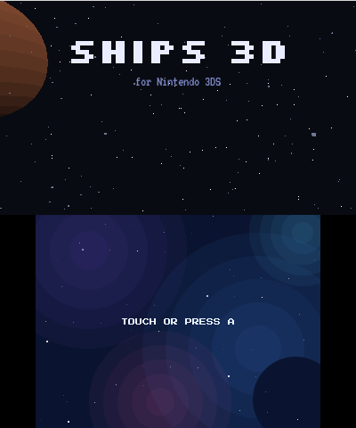
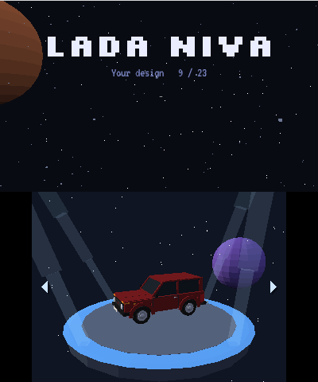
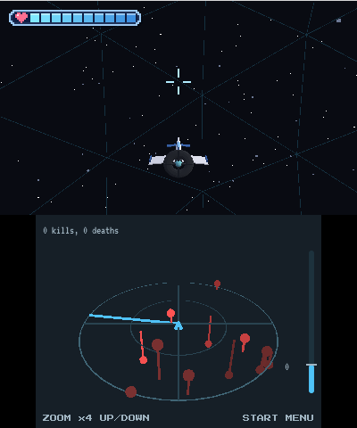
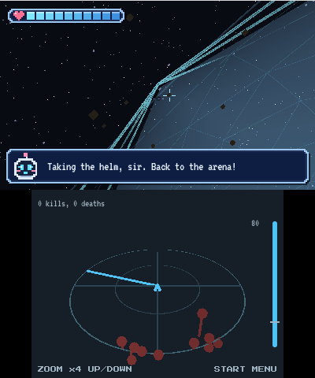

# Ships 3D for the Nintendo 3DS

A client for the [Ships 3D game server](https://github.com/jonbul/ships3D-api), for the New Nintendo 3DS (homebrew, `.3dsx`): it
logs in, lists your ships and joins the same games as the browser, over the same websocket and
HTTPS API. **Status: experiment**, written with an AI assistant and pending review. The plan is in
[docs/proposals/1-nintendo-3ds-client.md](docs/proposals/1-nintendo-3ds-client.md).

| Title | Hangar | Game | At the edge |
| --- | --- | --- | --- |
|  |  |  |  |

## Building

```bash
tinygo build -target=nintendo3ds -ldflags "-X runtime.heapMegabytes=64" -o ships3ds.3dsx ./cmd/ships3ds
```

It needs [TinyGo for 3DS](https://github.com/akrck02/tinygo-3ds) and devkitPro's libraries
(libctru, citro3d, and mbedtls from the portlibs for TLS). The console's pieces come from Go
modules: [go-3ds](https://github.com/akrck02/go-3ds) (the app loop, sockets, TLS, the SD card,
the keyboard), [go-renderer](https://github.com/akrck02/go-renderer) (3D on the console's GPU),
[go-ui](https://github.com/akrck02/go-ui) and [go-sound](https://github.com/akrck02/go-sound).

- `runtime.heapMegabytes=64` leaves C its share of the console's memory: without it TinyGo takes
  all it can, and the socket service doesn't find the megabyte it needs.
- `-X main.server=192.168.1.20:3000` starts with another server than the real one
  (`https://jonbul.ddns.net:3000`). A server written with `https://` is talked to over TLS.
- `-X main.logServer=192.168.1.20:7777` sends the game's log to a computer as it happens
  (`nc -lk 7777` there); it is also written to `sdmc:/3ds/ships3d/log.txt`.

Copy `ships3ds.3dsx` to `/3ds/` on the SD card (ftpd works) and open it from the Homebrew
Launcher. Sound needs the DSP's firmware, `sdmc:/3ds/dspfirm.cdc` (the DSP1 homebrew dumps it).

## Playing

The title, then the hangar: the cross (or a touch on either side) goes through the ships, A
flies the one turning on its platform, START opens the menu. Login and server are remembered on
the SD card, in `sdmc:/3ds/ships3d/profile.json`.

| Control | What it does |
| --- | --- |
| Circle pad | Nose and turn |
| R or A | Fire; A flies again after dying |
| C-stick, or left and right on the cross | Roll |
| ZR / ZL (also X / B) | Faster / slower |
| Tilting the console | Steers too, with *Steer by tilting* on; L centres it |
| Up / down on the cross | Radar zoom |
| START | The menu: PILOT, STATS, SETUP and ACCOUNT pages, L and R between them |

The top screen is the game in 3D (the 3D slider works), with your life at the top left. The
touch screen is a 3D radar that turns with the ship. Near the world's edge the force field shows,
the camera draws back, the copilot warns, and if you keep heading out it turns you back itself.

## The code

| Package | What it holds |
| --- | --- |
| `websocket`, `web` | A small websocket client and HTTP over the console's sockets |
| `protocol`, `account` | The server's messages, login and the list of ships |
| `game`, `flight` | The game's state and the same flight model as the server's |
| `ship`, `radar`, `chase`, `impact`, `tilt` | Ships' meshes, the radar, the camera, crash effects, the gyroscope |
| `chiptune`, `figures`, `profile` | Sounds made in code, frame figures, what the SD card remembers |
| `cmd/ships3ds` | The console's program: screens, menus, the hangar, the world |

All but `cmd/ships3ds` are plain Go, tested on a computer with `go test ./...` (the CI runs them).
